# Admin guide: running your store

This guide is for the store owner and staff. It shows how to use the **Kirana Admin** website to receive orders, pack and deliver them, keep stock up to date and change the store's rules. Orange numbers in each picture match the numbered notes below it.

> **Video:** a short walkthrough is in `guides/videos/Kirana-Store-Admin.mp4` (2 minutes). `Kirana-Walkthrough-Customer-then-Admin.mp4` shows the customer's side first and then the admin. They were recorded in English before Hindi, list requests, the **Accept order** step and the location map were added; this guide shows the current screens.

**Contents**

1. [Sign in](#1-sign-in)
2. [Dashboard](#2-dashboard)
3. [New orders: sound and pop-up](#3-new-orders-sound-and-pop-up)
4. [Find orders](#4-find-orders)
5. [Handle an order](#5-handle-an-order)
6. [Cancel an order](#6-cancel-an-order)
7. [List requests: photo or voice orders](#7-list-requests-photo-or-voice-orders)
8. [Print an invoice](#8-print-an-invoice)
9. [Products and stock](#9-products-and-stock)
10. [Add or edit a product](#10-add-or-edit-a-product)
11. [Categories](#11-categories)
12. [Store settings](#12-store-settings)
13. [On your phone, and dark mode](#13-on-your-phone-and-dark-mode)
14. [Daily routine](#14-daily-routine)
15. [Questions and problems](#15-questions-and-problems)

---

## 1. Sign in

Open the admin address you were given (for example `https://admin.yourstore.in`) in Chrome, Edge or Safari on a computer, tablet or phone. Bookmark it.

The admin opens in **Hindi**. Switch to **English** (or back) with the **हिंदी | English** buttons on the sign-in page or at the bottom of the menu; the choice is remembered on that computer. Most pictures below show the English screens.

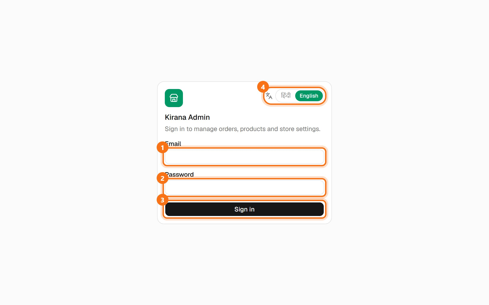

1. **Email** of the owner account.
2. **Password**.
3. **Sign in**.
4. **हिंदी | English**: the language of the admin.

After 5 wrong passwords the login is blocked for 15 minutes, to stop people guessing. Forgot the password? See [Questions](#15-questions-and-problems).

---

## 2. Dashboard

The first page shows today at a glance. It refreshes by itself every 30 seconds.

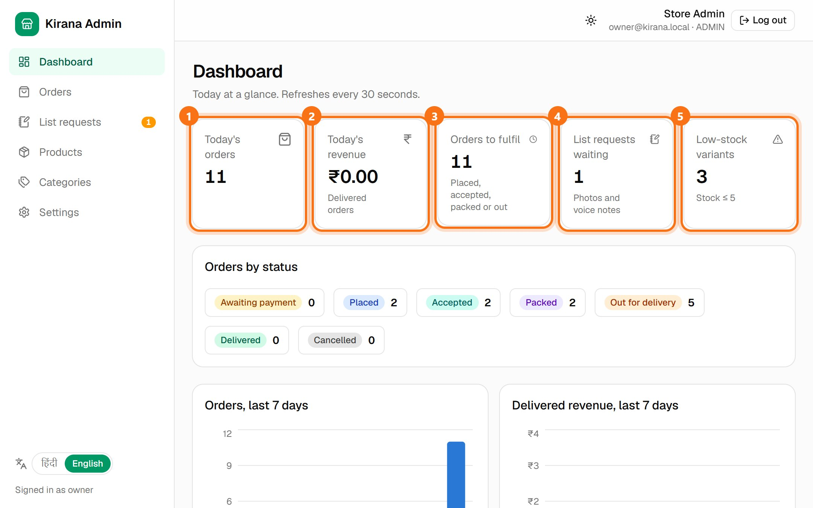

1. **Today's orders**: orders placed today.
2. **Today's revenue**: money from orders **delivered** today.
3. **Orders to fulfil**: orders that still need work (placed, accepted, packed or out for delivery).
4. **List requests waiting**: photos and voice notes from customers that still need an order (see [List requests](#7-list-requests-photo-or-voice-orders)).
5. **Low-stock variants**: product sizes with only a few left (you choose the number in Settings).

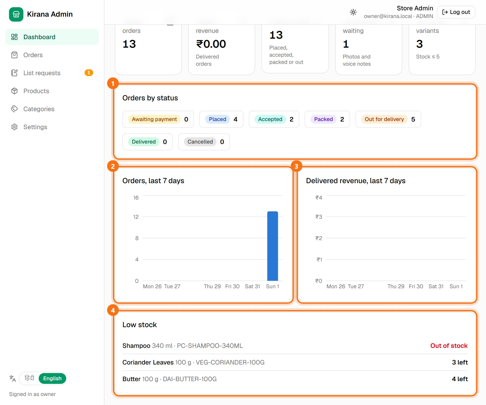

1. **Orders by status**: how many orders are at each stage right now.
2. **Orders, last 7 days**: hover a bar to see the exact number.
3. **Delivered revenue, last 7 days**.
4. **Low stock**: what to restock, with how many are left. "Out of stock" items can't be ordered until you add stock.

---

## 3. New orders: sound and pop-up

Keep the admin open in a browser tab while the store is open. It checks for new orders every 10 seconds.

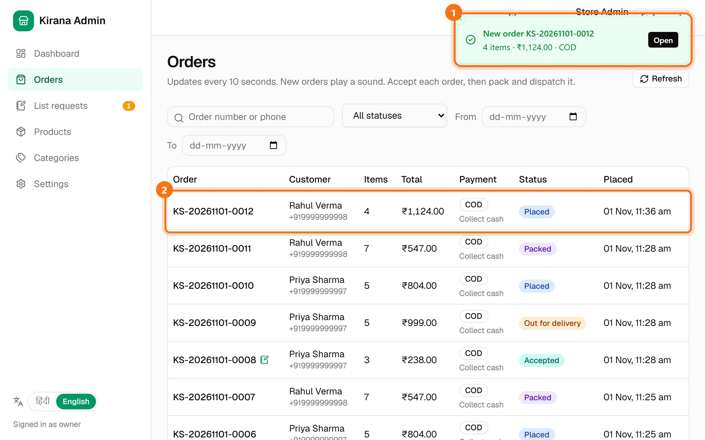

1. A new order plays a short **chime** and shows a pop-up with the order number, item count, total and payment type. Click **Open** to go straight to it.
2. The new order appears at the top of the Orders list as **Placed**.

**Make sure you hear it:** browsers allow sound only after you click somewhere on the page once. After opening the admin, click anywhere on the page. Keep the computer's volume up and don't let it sleep.

---

## 4. Find orders

Click **Orders** in the menu.

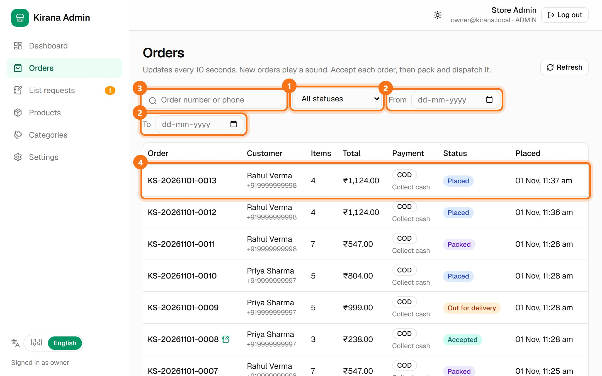

1. **Status**: show only Placed, Accepted, Packed, Out for delivery, Delivered, Cancelled or Awaiting payment.
2. **From / To**: show orders placed between two dates.
3. **Search**: type an order number or the customer's phone number.
4. Click any **row** to open the order.

The **Payment** column shows **COD** (cash on delivery) with **Collect cash** until it is delivered, then **Cash collected**. Online orders show whether they are paid.

---

## 5. Handle an order

Click an order to open its details on the right.

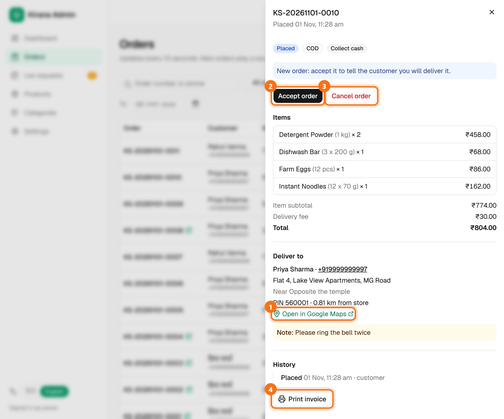

1. **Open in Google Maps**: the exact delivery location, for the delivery person. The customer's name and phone number are just above it; on a phone, tap the number to call.
2. **Accept order** for a new order, then **Mark packed** when it is packed. The customer's app updates straight away after each step.
3. **Cancel order**: see [Cancel an order](#6-cancel-an-order).
4. **Print invoice**.

The blue line at the top reminds you to accept new orders. The yellow box shows the customer's **note** (for example "Ring the bell twice"). **History** lists every change with the time and who made it.

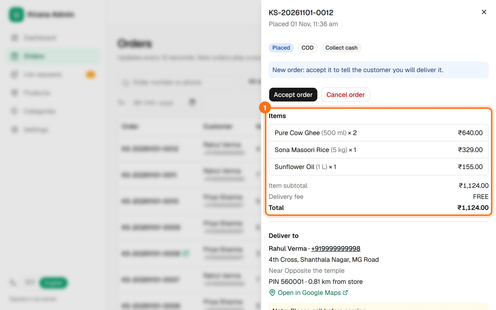

1. **Items** with quantities and prices, the delivery fee and the **Total** to collect.

Every order is accepted first (**Accept order**), then packed. After **Mark packed**, the next button appears:

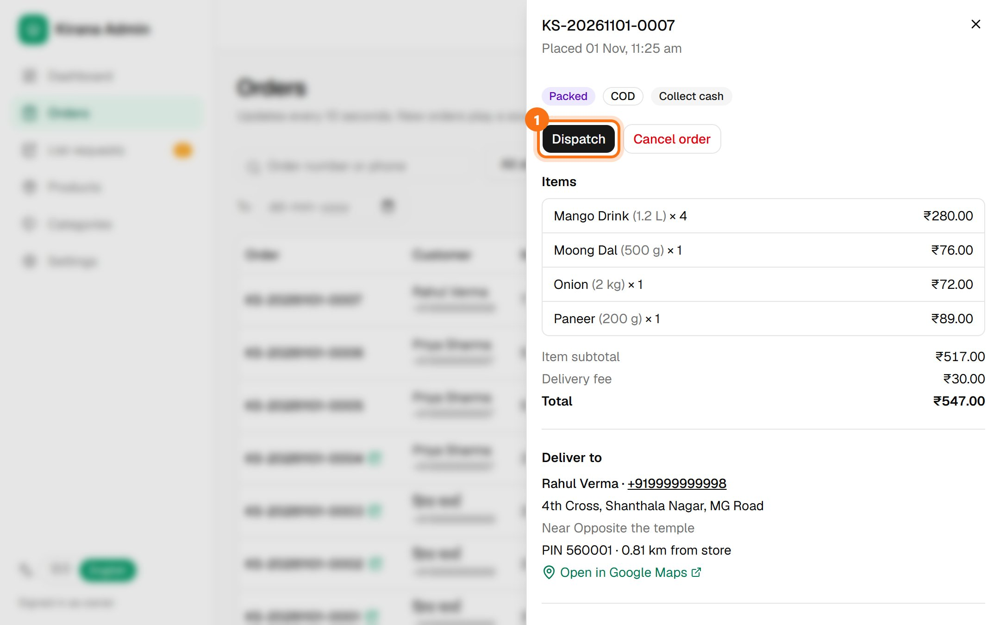

1. **Dispatch** (Out for delivery) when it leaves the shop, then **Mark delivered** when the customer has it.

| Status | Meaning | Next step |
|---|---|---|
| **Awaiting payment** | Online order, customer hasn't paid yet (cancelled automatically after 15 minutes) | Wait; don't pack yet |
| **Placed** | New order, not yet seen by the store. The customer can still cancel it | **Accept order** |
| **Accepted** | You will fulfil it. The customer can still cancel until it is packed | Pack it, then **Mark packed** |
| **Packed** | Ready to go | **Dispatch** |
| **Out for delivery** | On the way | **Mark delivered** |
| **Delivered** | Done, cash collected | Nothing |
| **Cancelled** | Stopped; stock went back | Nothing |

Delivered and Cancelled orders can't be changed.

---

## 6. Cancel an order

Use this when an item is missing, the customer can't be reached, or the customer asks to cancel. Customers can cancel by themselves only before you mark the order packed.

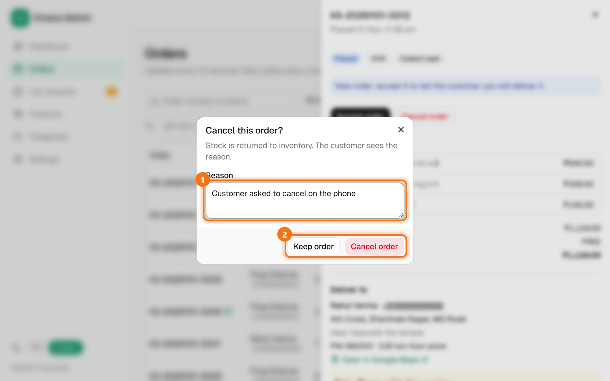

1. Type a short **reason**. The customer sees it in the app.
2. Click **Cancel order** to confirm, or **Keep order** to go back.

The items go back into stock automatically.

---

## 7. List requests: photo or voice orders

Customers can send a photo of their handwritten list (parchi) or a voice note instead of picking items. They appear under **पर्ची ऑर्डर (List requests)** in the menu, with a count of waiting ones, and on the dashboard. A new one plays the same chime as a new order. These pictures show the admin in Hindi.

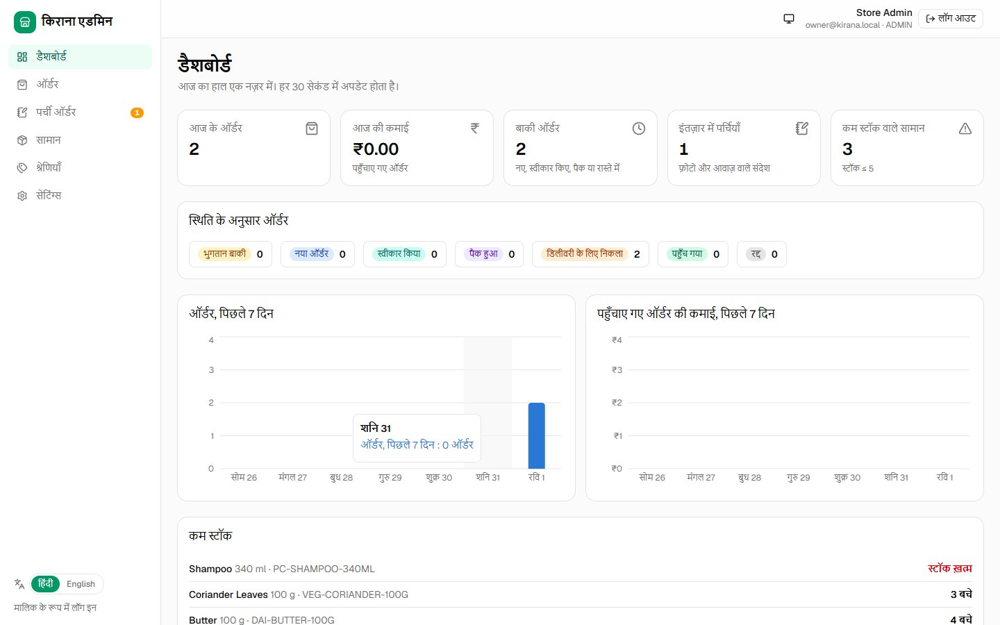

Open **List requests** and click a request.

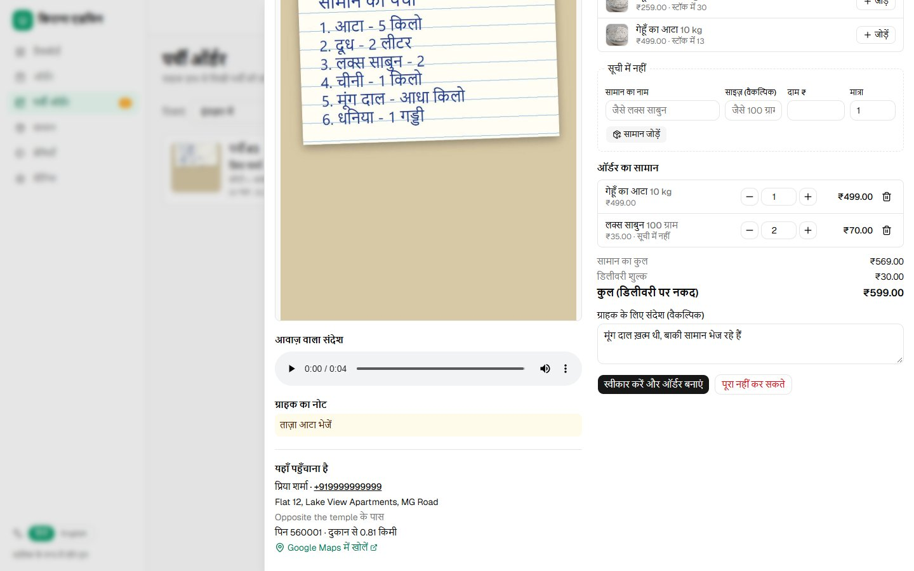

1. **Left side:** the list photo (use **Rotate** and the zoom buttons to read handwriting; **Open full size** opens it in a new tab), the **voice note** player, the customer's note, name, phone and address.
2. **Search the catalog** (Hindi or English names) and click **Add** next to the right size. Click again or use **+ / −** to change the quantity. Out-of-stock sizes can't be added.
3. **Not in catalog:** for something you sell that isn't listed, type the name, size and price and click **Add item**. No stock is tracked for these.
4. Check the **total**: the delivery charge follows your settings (free above your free-delivery amount). The minimum order does **not** apply to list requests.
5. Optionally write a **message to the customer** (for example "Amul butter was out, sent Mother Dairy").
6. Click **Accept and create order**. The order is created as **Accepted**, cash on delivery, and the customer sees it with the bill straight away. Stock goes down for catalog items.

If you can't fulfil it, click **Cannot fulfil**, type a reason (for example "Could not read the list, please send a clearer photo") and confirm; the customer sees the reason and can send a new request.

The created order then works like any other order (pack, dispatch, deliver). Its details show **Made from list request #…** with an **Open request** button, so you can look at the photo or listen again while packing.

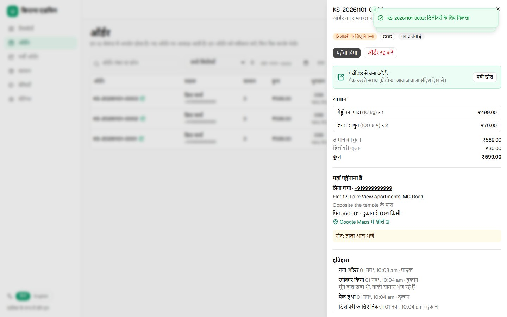

---

## 8. Print an invoice

In the order details, click **Print invoice**. It opens in a new tab.

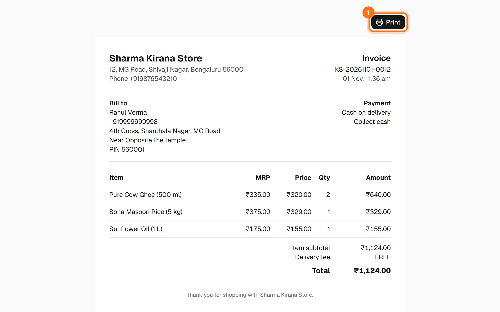

1. Click **Print**. To keep a PDF instead, choose **Save as PDF** as the printer.

The invoice shows the store's name, address, phone and GSTIN (if you entered one in Settings), the customer, every item with MRP and price, and the totals.

---

## 9. Products and stock

Click **Products** in the menu. Changes here save immediately.

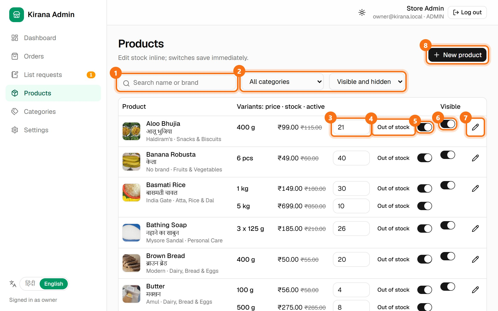

1. **Search** by product name or brand.
2. Show one **category**, and **visible**, **hidden** or all products.
3. **Stock**: type the new number and press **Enter** (or click elsewhere). A message confirms "Stock updated".
4. **Out of stock**: sets that size's stock to 0 in one click. Customers see it as out of stock and can't order it.
5. **Size switch**: turns one size off (for example stop selling the 5 kg pack) without deleting it.
6. **Visible**: hides or shows the whole product in the app.
7. **Edit** (pencil): change details, prices and photo.
8. **New product**.

Stock goes down automatically when an order is placed, and back up if it is cancelled.

---

## 10. Add or edit a product

Click the pencil next to a product, or **New product**.

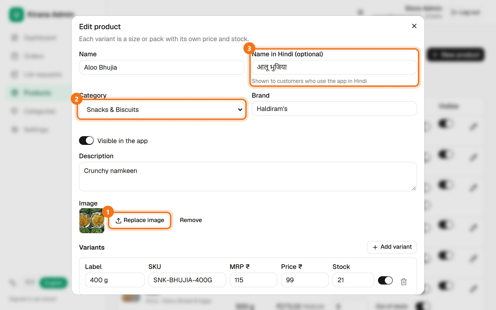

1. **Image**: click **Upload image** or **Replace image** and choose a photo (JPG, PNG or WebP, up to 2 MB). Square photos look best. **Remove** deletes it; the app then shows an illustration for the category.
2. **Category**: where the product appears in the app.
3. **Name in Hindi** (optional): shown to customers who use the app in Hindi, and found by Hindi search (for example "आटा"). Leave it empty to show the English name.

Also fill in **Name**, **Brand** (optional), **Description** (optional) and **Visible in the app**.

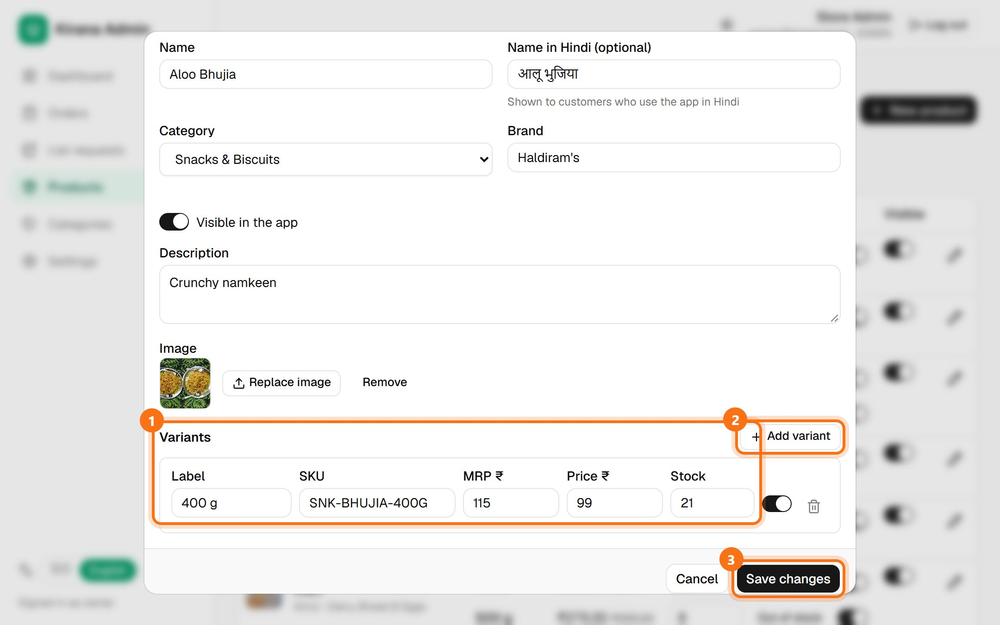

1. **Variants** are the sizes or packs you sell, each with its own **Label** (for example "1 kg"), **SKU** (your own short code, must be unique), **MRP**, **selling Price** and **Stock**. The switch turns that size on or off; the bin icon removes it.
2. **Add variant** for another size.
3. **Save changes** (or **Create product** for a new one).

The price must not be higher than the MRP. The app shows the difference as the discount.

---

## 11. Categories

Click **Categories** in the menu.

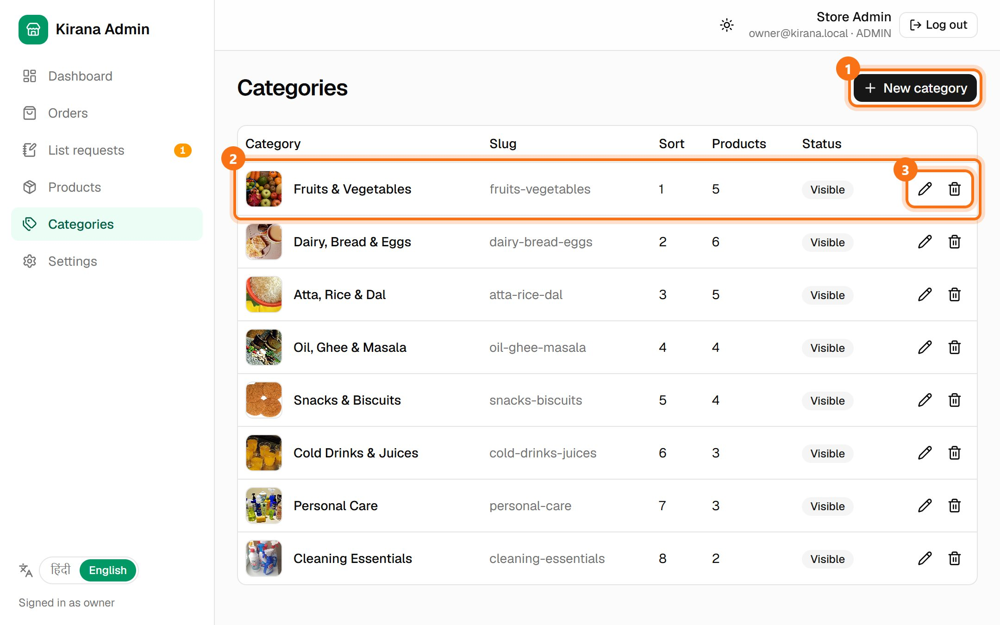

1. **New category**.
2. Each row shows the photo, the short web name (slug), the **sort order**, how many products it has and whether it is visible.
3. **Edit** (pencil) or **Delete** (bin). A category that still has products is **hidden** instead of deleted, so nothing is lost.

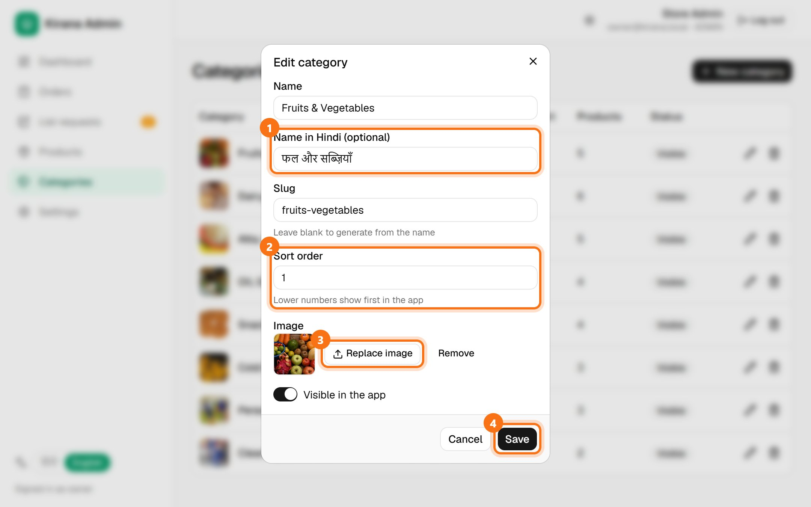

1. **Name in Hindi** (optional): shown when the app is in Hindi.
2. **Sort order**: lower numbers show first in the app (1 is first).
3. **Image**: shown on the app's home screen.
4. **Save**.

Leave **Slug** empty to create it from the name. **Visible in the app** hides or shows the whole category.

---

## 12. Store settings

Click **Settings** in the menu. Only the owner account can see this page. Click **Save settings** at the bottom when you are done. Customers see the change the next time they open the app or pull down to refresh, and every new order is checked against the latest settings.

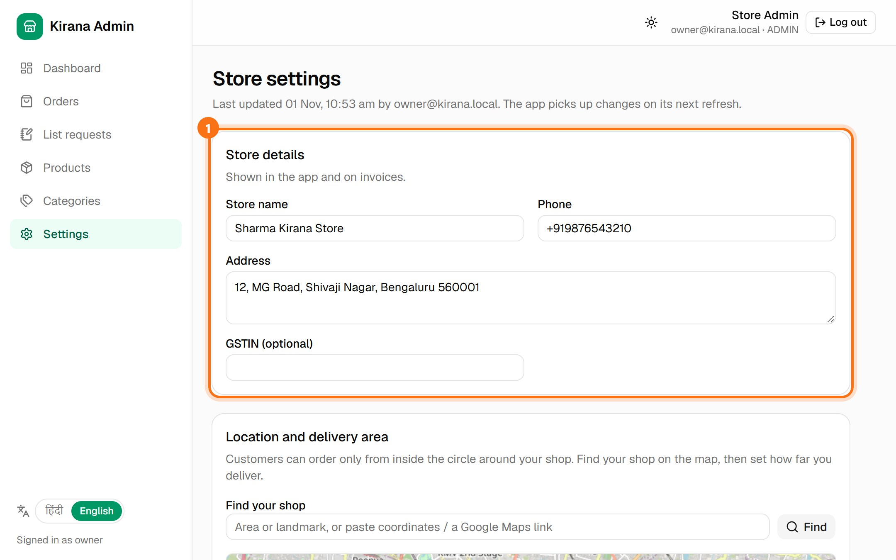

1. **Store details**: name, phone, address and GSTIN (optional). These appear in the app (the **Call the store** button uses this phone number) and on invoices.

**Location and delivery area.** Put the pin exactly on your shop and choose how far you deliver. Customers can order only from addresses inside the blue circle.

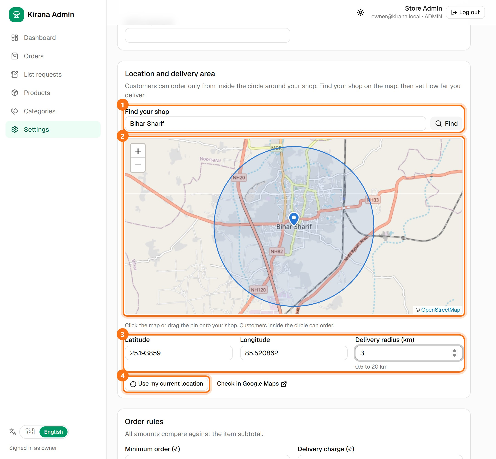

1. **Find your shop**: type your area or a landmark (for example "Station Road, Bihar Sharif") and click **Find** (or press Enter), then click the right result. If the box is empty, **Find** searches the store address above. You can also paste:
   - the shop's coordinates, like `25.1971, 85.5236`. In Google Maps, right-click (on a phone, long-press) your shop and copy the numbers at the top;
   - a full Google Maps link. Short `maps.app.goo.gl` links can't be read: open them and copy the numbers instead.
2. **Map**: click the map or drag the pin onto your shop's building. Zoom with **+** and **−**. The circle shows the delivery area and moves with the pin.
3. **Latitude, longitude and delivery radius (km)**: the pin's exact position, which you can also type. The radius can be 0.5 to 20 km, for example 5. The map zooms out to show the whole circle when you change it.
4. **Use my current location**: works best on a phone while you are **inside the shop**. On a computer the browser often knows only roughly where you are (by internet connection); the admin then warns you, so zoom in and drag the pin onto the shop. **Check in Google Maps** opens the pin in Google Maps.

The distance is measured in a straight line from the pin. After you save, it applies straight away to the app's "we deliver here" message on the home and address screens, to every new order, and to new list requests. Orders and requests already placed are not affected.

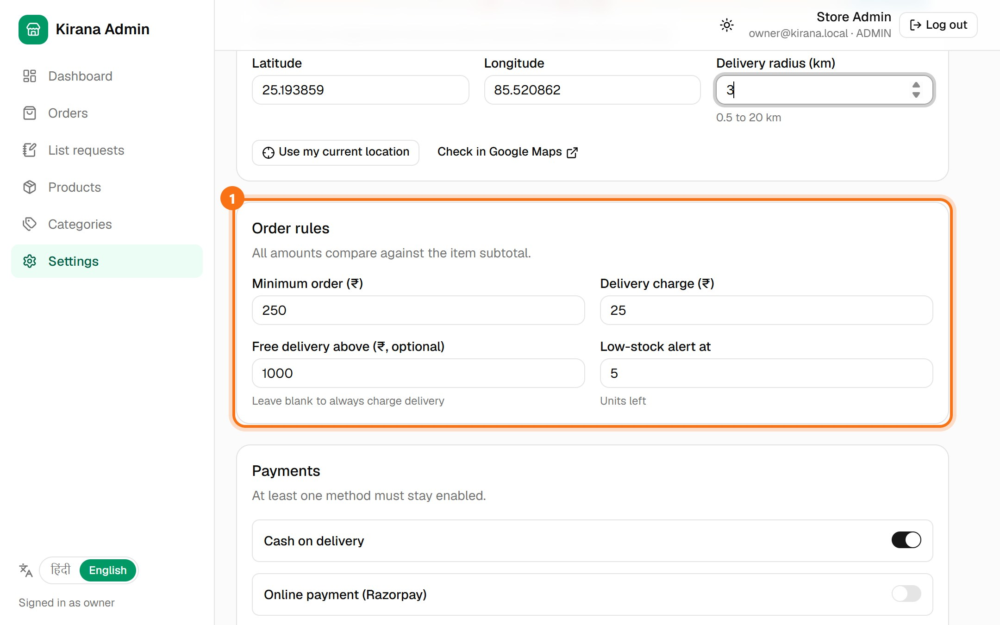

1. **Order rules**:
   - **Minimum order (₹)**: customers can't order below this item total.
   - **Delivery charge (₹)**: added to each order.
   - **Free delivery above (₹)**: no delivery charge when the item total reaches this. Leave empty to always charge.
   - **Low-stock alert at**: sizes with this many or fewer left show on the dashboard.

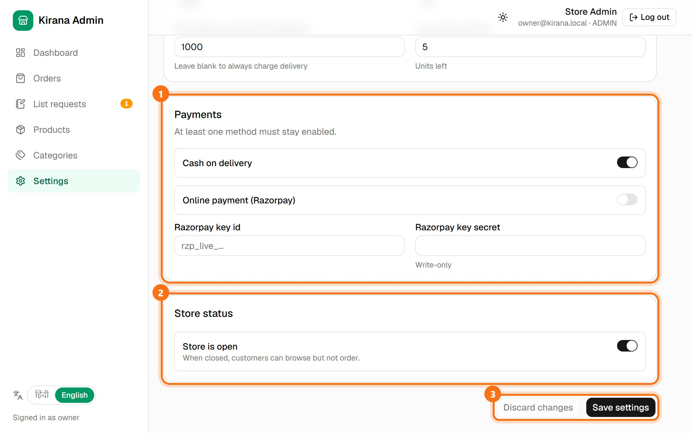

1. **Payments**:
   - **Cash on delivery**: on or off.
   - **Online payment (Razorpay)**: on or off. It needs your Razorpay **key id** and **key secret** (from the Razorpay dashboard). The secret is never shown again after saving; leave it empty to keep the saved one. At least one payment method must stay on.
2. **Store status**: switch **Store is open** off to pause ordering (holidays, stock-taking, end of day) and type a **message** customers will see, for example "Closed today, back tomorrow at 8 AM". Customers can still browse.
3. **Save settings**. **Discard changes** undoes what you typed.

---

## 13. On your phone, and dark mode

The admin works in a phone's browser too.

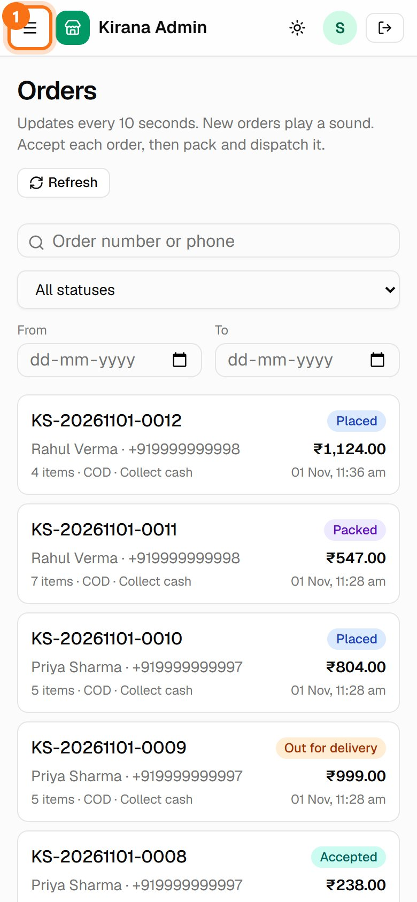 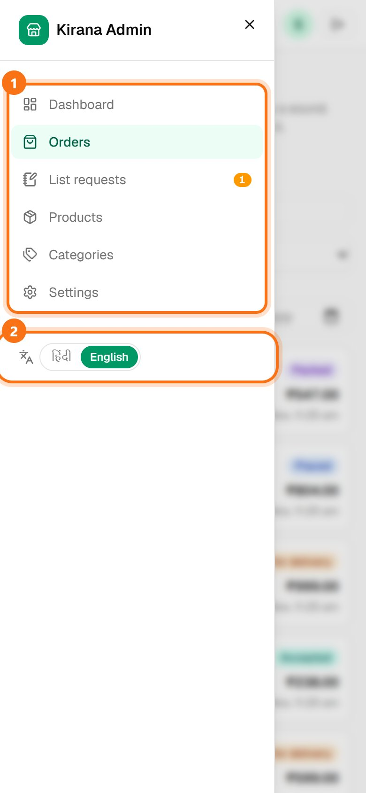

1. Tap the **menu** button (three lines) to move between Dashboard, Orders, List requests, Products, Categories and Settings.
2. **हिंदी | English** switches the language.

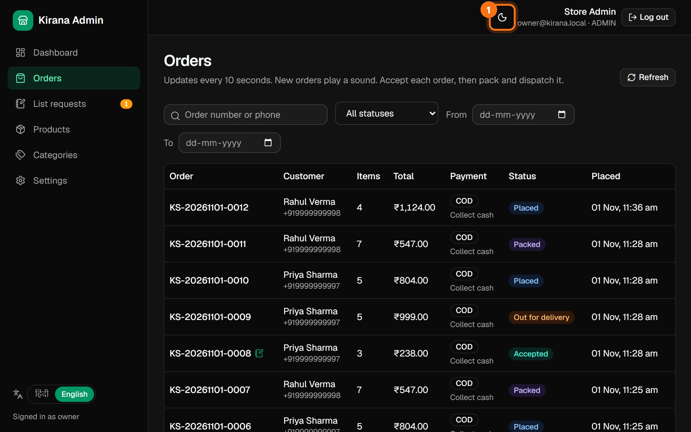

1. The **theme** button in the top bar switches between light, dark and your device's setting.

---

## 14. Daily routine

**Opening the shop**

1. Open the admin, sign in, and click once on the page so new-order sounds can play.
2. Check **Low stock** on the dashboard and update stock for anything you received.
3. If you closed the store in Settings, switch **Store is open** back on.

**During the day**

1. When the chime plays, open the order and click **Accept order**; pack it and click **Mark packed**.
2. Click **Dispatch** when it leaves, and **Mark delivered** when it arrives and cash is collected.
3. Check **List requests** for photos and voice notes, build the order and accept it (or decline with a reason).
4. If you run out of something, click **Out of stock** next to it so no one else orders it.

**Closing**

1. Make sure no orders are left in **Placed**, **Accepted** or **Packed** (filter Orders by status) and no list requests are waiting.
2. Switch **Store is open** off with a message about when you reopen, or leave it on if you accept orders for the next morning.

---

## 15. Questions and problems

**No sound for new orders.** Click once anywhere on the admin page after opening it, check the computer's volume, and keep the tab open (don't close the browser or let the computer sleep). New orders also show in the list and on the dashboard.

**A customer says they can't order.**
- "We don't deliver here yet": their address is outside your delivery radius (Settings → delivery radius).
- "Add ₹X more to enable order": below your minimum order.
- "Store is closed": switch **Store is open** on.
- An item shows out of stock: add stock in Products.

**The delivery area seems wrong.** Open **Settings** and look at the map: the pin must sit on your shop and the circle must cover the area you deliver to. Search for the shop or drag the pin, adjust the radius, and save. "Use my current location" from a computer can be kilometres off; use it on a phone inside the shop.

**I changed a price, but a customer paid the old price.** Orders keep the price at the moment they were placed. If a customer's cart has an old price when they order, the app shows them the new total first.

**I forgot the admin password.** There is no reset link. The person who set up your server can reset it in a few minutes (Deployment guide, section 12, "Reset the owner's admin password").

**Can staff have their own login?** Not yet; there is one owner account. Share it only with people you trust, and change the password if someone leaves.

**Customers get no SMS codes.** Real SMS needs the MSG91 service set up on the server (Deployment guide, section 11). Until then, codes appear only in the server log.
