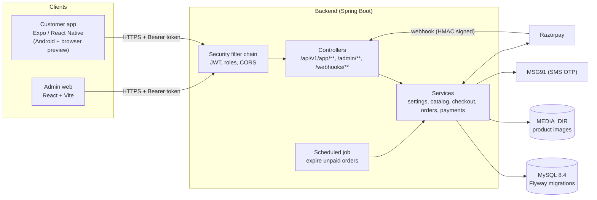
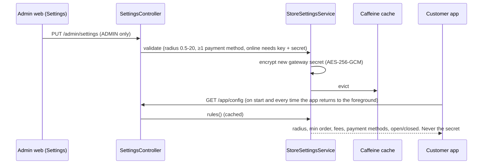
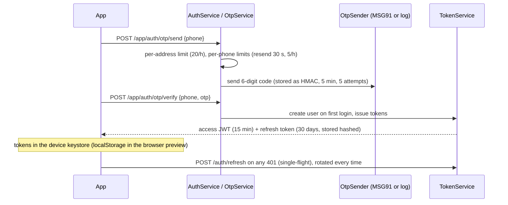
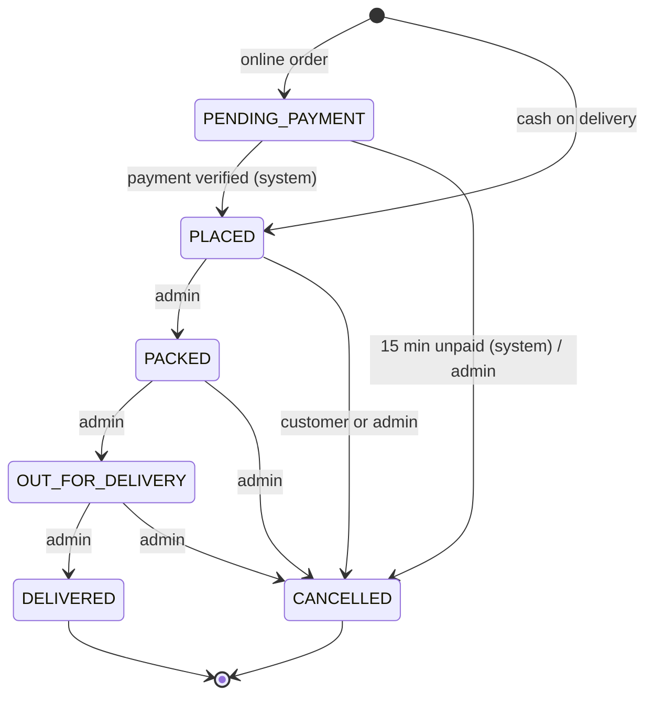

# Architecture and code flow

How the three apps fit together, how a request moves through them, and where each rule lives. For endpoint details see [API.md](API.md); for the reasons behind choices see [DECISIONS.md](DECISIONS.md).

## System overview



| Layer | Where | Responsibility |
|---|---|---|
| Customer app | `customer-app/src` | Browse, cart (persisted on device), addresses, checkout, tracking. Displays rules, never decides them. |
| Admin web | `admin-web/src` | Orders desk, catalog, store settings, dashboard. |
| Backend | `backend/src/main/java/com/kirana/<feature>` | The single source of truth: every price, rule, stock change and status change happens here. |
| Database | `backend/src/main/resources/db/migration` | Schema (V1) and seed data (V2); Hibernate only validates. |

Backend packages are by feature: `auth`, `settings`, `catalog`, `customer`, `checkout`, `order`, `payment`, `storage`, `dashboard`, plus `common` (errors, money, crypto, rate limiting) and `config` (security, CORS, caching, OpenAPI).

## 1. Store rules: one row, everywhere



- `store_settings` has exactly one row (`CHECK (id = 1)`). `StoreSettingsService.rules()` returns an immutable `StoreRules` snapshot that is cached and evicted on every update.
- The gateway secret is write-only: stored encrypted, exposed only as `gatewaySecretSet`.
- The app shows rules (min-order bar, free-delivery hint, payment options) but the server re-checks all of them when the order is placed.

## 2. Customer login (OTP)



Reusing an already-rotated refresh token revokes every session of that user (theft detection). Admin login is email + BCrypt password with a 5-failures / 15-minute lockout per email and address.

## 3. Checkout and order placement

```mermaid
sequenceDiagram
  participant App as CartScreen
  participant V as StoreValidationService
  participant O as OrderService
  participant DB as MySQL
  App->>V: POST /app/cart/validate (debounced 400 ms)
  V-->>App: CartQuote: server prices, fee, total, serviceable, violations[]
  Note over App: Place order enabled only when the quote is clean
  App->>O: POST /app/orders + Idempotency-Key + expectedTotal
  O->>DB: insert idempotency key (unique per user)
  O->>V: recompute quote at the saved address's coordinates
  alt any violation
    O-->>App: 422 STORE_CLOSED / OUT_OF_RADIUS / BELOW_MIN_ORDER / ... (rolled back)
  else total differs from expectedTotal
    O-->>App: 409 PRICE_CHANGED + fresh quote (app asks to confirm)
  end
  O->>DB: UPDATE stock = stock - qty WHERE stock >= qty (per line, id order)
  alt any line updated 0 rows
    O-->>App: 409 OUT_OF_STOCK + variantIds (everything rolled back)
  end
  O->>DB: order + item snapshots + status history + payment row
  O-->>App: 201 OrderDetail (COD: PLACED; online: PENDING_PAYMENT + Razorpay order)
```

Key guarantees:
- **Prices** come only from the server; order lines snapshot name, MRP and price so later edits never change old orders.
- **Stock** never goes negative: the conditional `UPDATE` makes two buyers of the last unit race safely (one wins, one gets `OUT_OF_STOCK`).
- **Double taps** create one order: the idempotency key row is written first, a concurrent duplicate blocks on the unique index and then receives the original order.
- **Delivery area** is checked against the saved address (lat/lng), not live GPS, which only drives the home banner.

## 4. Order lifecycle



`OrderStateMachine` is the only place transitions are defined; every change locks the order row, writes `order_status_history`, restores stock on cancel, and marks COD as collected on delivery. The admin web mirrors the machine (`admin-web/src/lib/orderStatus.ts`) only to decide which buttons to show; the server still rejects anything invalid with `409 INVALID_STATUS_TRANSITION`.

Live tracking is polling: the app refetches an open order every 15 s until it is delivered or cancelled; the admin orders desk refetches every 10 s and plays a chime for new `PLACED` orders.

## 5. Online payment (Razorpay, behind the settings toggle)

1. `POST /app/orders` with `ONLINE` creates a Razorpay order server-side (key id + decrypted secret) and returns `payment.gatewayOrderId`.
2. The app opens Razorpay checkout (native module, Android build only).
3. The app sends the result to `POST /app/payments/razorpay/verify`; the server checks `HMAC(order_id|payment_id, secret)`.
4. Razorpay's webhook (`payment.captured` / `order.paid`, HMAC of the raw body) confirms the same payment independently; both paths are idempotent.
5. `PendingPaymentExpiryJob` cancels orders still unpaid after 15 minutes and releases their stock; a payment arriving later is marked `REFUND_PENDING`.

## Frontend structure

**Customer app** (`customer-app/src`)

| Folder | Contents |
|---|---|
| `navigation/` | Auth stack (Login, OTP) or app stack (tabs + screens), web URLs and `kirana://` deep links |
| `screens/` | One file per screen |
| `components/` | `ui.tsx` (buttons, cards, empty/error states), product card and grid, cart bar, banners, toasts, error boundary, layout containers |
| `hooks/` | TanStack Query hooks (`queries.ts`), responsive breakpoints (`useLayout.ts`), live serviceability |
| `store/` | Zustand: cart (persisted), session and checkout choices |
| `lib/` | API client with token refresh, money and checkout rules, platform adapters (`*.web.ts`) |

Responsive rules live in `computeLayout()` (unit tested): 2 product columns on phones up to 6 on desktop, 4 to 8 category columns, two-pane cart and order detail from 900 px, content capped at 1200 px.

**Admin web** (`admin-web/src`): `pages/` (one per route, lazy loaded), `components/` (layout shell, order drawer, forms, shadcn/ui primitives in `ui/`), `lib/` (API client, query hooks, Zod schemas mirroring the backend DTOs, theme). Below the `md` breakpoint tables become card lists and navigation moves into a slide-out menu; light, dark and system themes are supported.

## Error handling

Every non-2xx response is `{code, message, details}` (`GlobalExceptionHandler`, plus JSON 401/403 from the security chain). Clients branch on `code`, never on message text:

| Code | Customer app reaction |
|---|---|
| `PRICE_CHANGED` | Shows the new total and asks to confirm |
| `OUT_OF_STOCK` / `VARIANT_INACTIVE` | Marks the lines and offers to remove them |
| `UNAUTHORIZED` | Silent refresh once; back to login if that fails |
| Network error | "No connection to the store" with a retry button |

Render crashes are caught by an error boundary (both apps) instead of a blank screen.

## Production checklist

| Area | State |
|---|---|
| Secrets | Env only; DB secret encrypted at rest; never logged or returned |
| Auth | Short-lived JWT, rotating refresh tokens with reuse detection, BCrypt, admin lockout, OTP limits per phone and per address |
| Transport | `prod` profile honours proxy headers; Android release builds refuse plain HTTP and require an `https://` API URL |
| Data integrity | DB constraints (stock ≥ 0, price ≤ MRP, singleton settings), conditional stock updates, idempotency keys, row locks on status changes |
| Observability | `/actuator/health` (liveness/readiness), ECS JSON logs in `prod` |
| Tests | Backend 76 (unit + Testcontainers MySQL), admin web 26 (Vitest), customer app 38 (Jest) |
| Known limits | In-memory rate limits are per instance (use Redis or a gateway limit when running several instances); no push notifications yet (polling) |
