# Customer guide: ordering from your kirana

This guide shows how to order groceries from your neighbourhood store with the **Kirana app**, step by step. Each picture has orange numbers that match the numbered notes below it.

> **Video:** the same steps are in a short video, `guides/videos/Kirana-Customer-App.mp4` (3½ minutes). It was recorded in English before Hindi, list requests and the store's Accept step were added; everything it shows still works the same way.

**Language:** the app opens in **Hindi**. To use English, tap **English** on the login screen, or go to **खाता (Account) → भाषा (Language)**. Most pictures below show the English screens; the steps are the same in Hindi.

The store decides its own delivery area, minimum order, delivery charge and free-delivery amount. The app always shows the current values. The pictures use a demo store with a ₹500 minimum order, ₹30 delivery, free delivery above ₹1,000 and a 5 km delivery area.

**Contents**

1. [Install the app](#1-install-the-app)
2. [Log in](#2-log-in)
3. [Check that the store delivers to you](#3-check-that-the-store-delivers-to-you)
4. [Find products](#4-find-products)
5. [Add to your cart](#5-add-to-your-cart)
6. [Your cart and the bill](#6-your-cart-and-the-bill)
7. [Add a delivery address](#7-add-a-delivery-address)
8. [Pay and place the order](#8-pay-and-place-the-order)
9. [Send your list instead: photo or voice](#9-send-your-list-instead-photo-or-voice)
10. [Track your order](#10-track-your-order)
11. [Cancel an order](#11-cancel-an-order)
12. [Your orders, account and addresses](#12-your-orders-account-and-addresses)
13. [Messages you may see](#13-messages-you-may-see)
14. [Questions](#14-questions)

---

## 1. Install the app

The store gives you the app as a link or a file called **`.apk`** (or, once published, on the Google Play Store).

1. Open the link on your Android phone and download the file.
2. Tap the downloaded file. If Android asks, allow **Install unknown apps** for your browser or file manager, then go back.
3. Tap **Install**, then **Open**.

No Android phone? The store can also share its **shop website** link. It works the same way in any phone or computer browser (online payment needs the Android app).

---

## 2. Log in

You log in with your mobile number. There is no password.

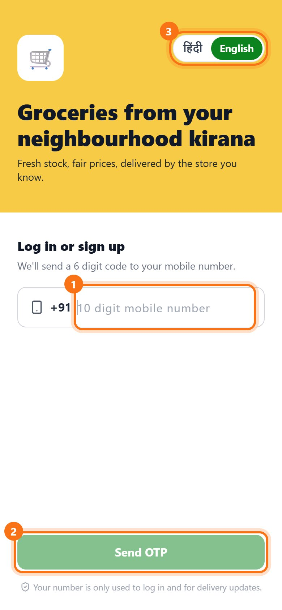

1. Type your **10-digit mobile number**.
2. Tap **Send OTP**.
3. **हिंदी | English**: the app starts in Hindi; tap **English** to switch. You can change it later in **Account**.

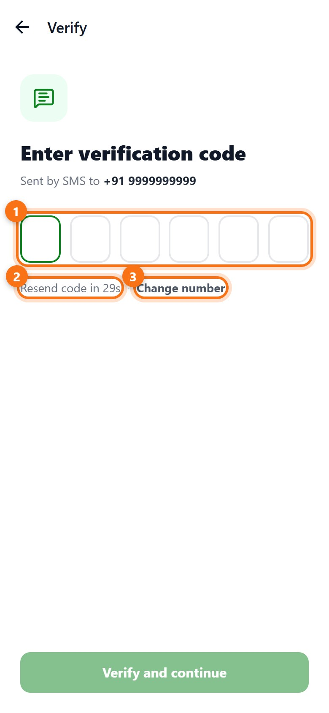

1. Type the **6-digit code** from the SMS. The app continues by itself once all six digits are in.
2. No SMS? Wait for the timer, then tap **Resend code**.
3. Wrong number? Tap **Change number**.

The code works for 5 minutes. After 5 wrong tries, ask for a new code. You stay logged in on your phone for 30 days.

---

## 3. Check that the store delivers to you

The first time, the home screen asks to check your location.

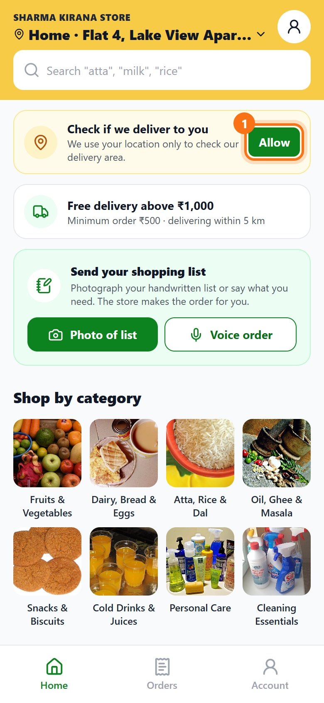

1. Tap **Allow**, then allow location when your phone asks. The location is used only to check the delivery area.

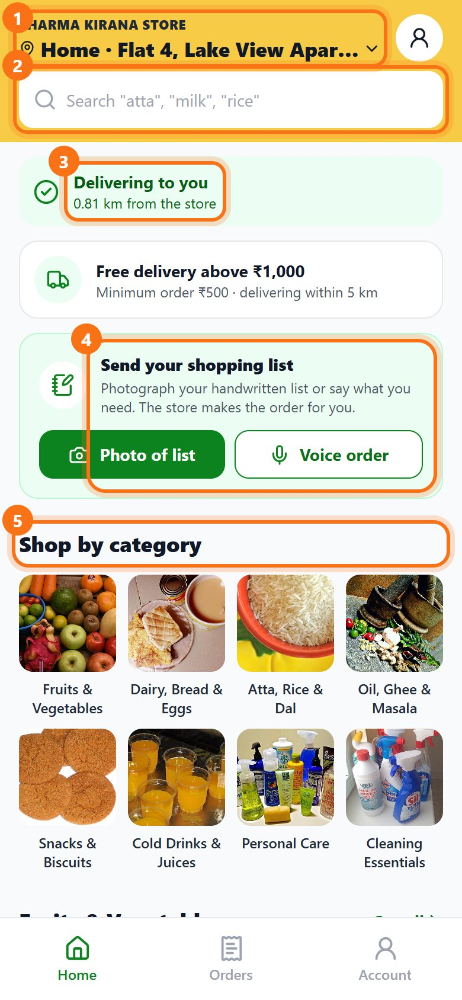

1. **Delivery address**: tap to choose or add where your order should go.
2. **Search**: find any product by name, in English or Hindi.
3. **Green banner**: the store delivers to where you are, and how far you are from the store.
4. **Send your shopping list**: send a photo of your handwritten list or a voice note instead of picking items (see [step 9](#9-send-your-list-instead-photo-or-voice)).
5. **Categories**: tap one to see everything in it.

If you prefer not to share your location, tap **Don't allow**. You can still shop and add your address by hand later (step 7).

---

## 4. Find products

Scroll down the home screen to see products from each category.

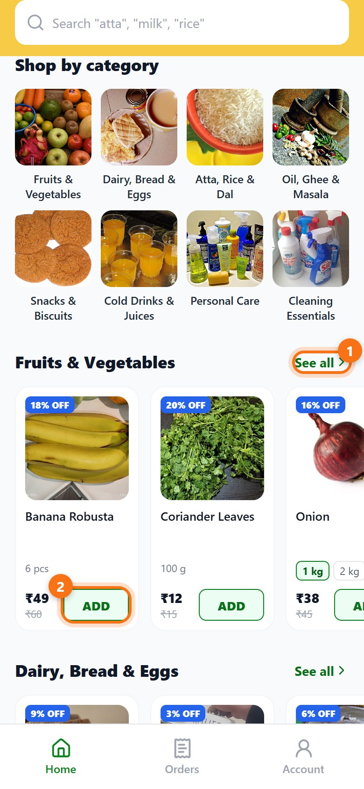

1. **See all** opens the whole category.
2. **ADD** puts the item in your cart.

The blue label shows today's discount. The crossed-out price is the MRP.

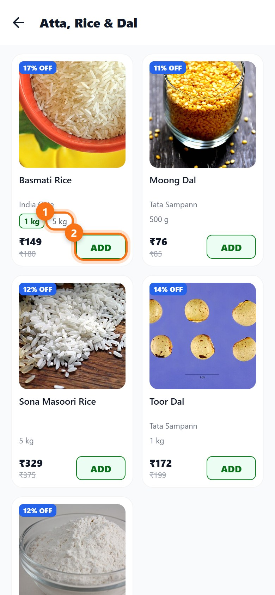

1. Some items come in more than one size (for example **1 kg** and **5 kg**). Tap a size to see its price.
2. Tap **ADD** to add the selected size.

To search, tap the search bar on the home screen and type a few letters.

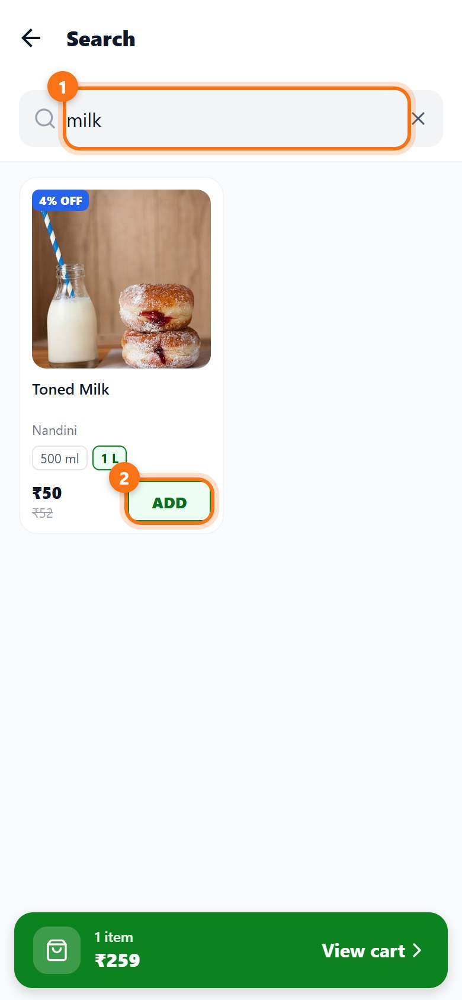

1. Type what you want, for example **milk**. Results appear as you type.
2. Pick the size and tap **ADD**.

---

## 5. Add to your cart

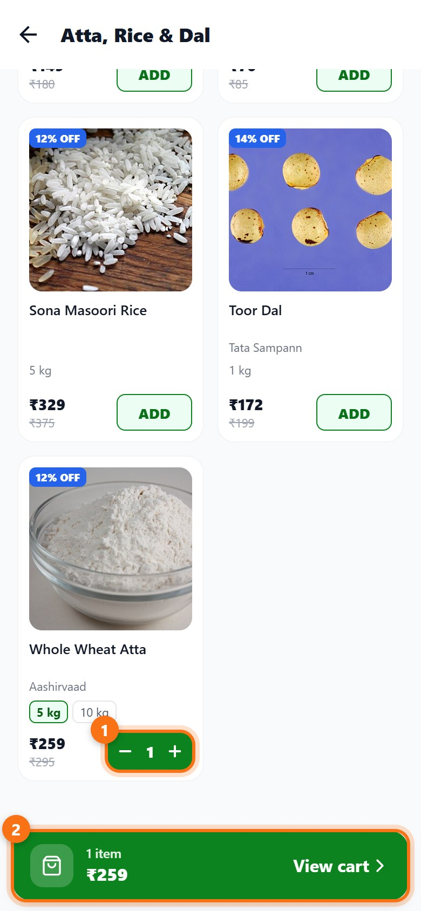

1. After you tap **ADD**, the button becomes **−  1  +**. Tap **+** for more, **−** for less (down to 0 removes it).
2. The green bar at the bottom shows how many items you have and the total. Tap **View cart** when you are ready.

Your cart is saved on the phone, so you can close the app and come back later.

---

## 6. Your cart and the bill

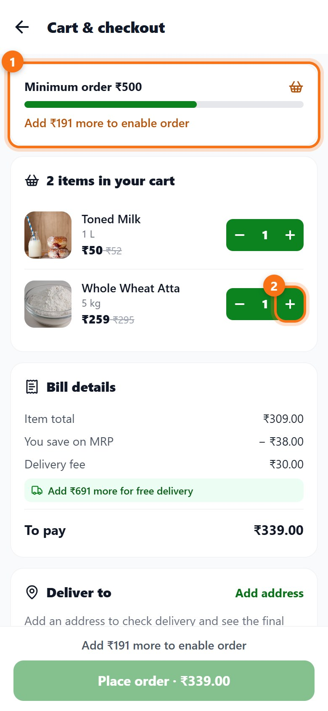

1. **Minimum order**: the bar shows how much more you need to add before you can order.
2. Change quantities right here with **−** and **+**.

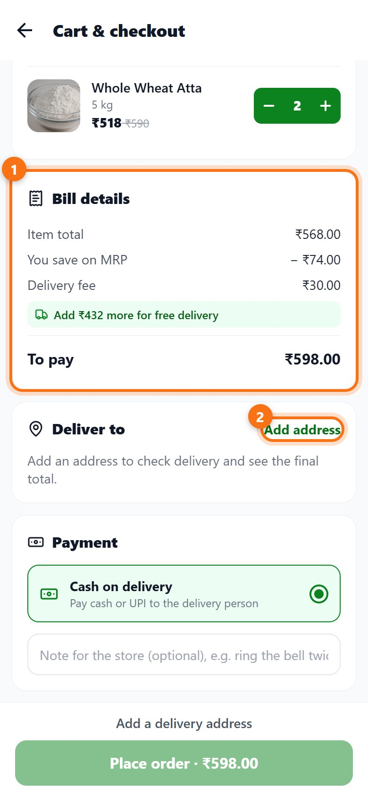

1. **Bill details**: item total, what you save on MRP, the delivery fee, and how much more you need for **free delivery**. **To pay** is the final amount.
2. **Add address**: needed before you can place the order (next step).

---

## 7. Add a delivery address

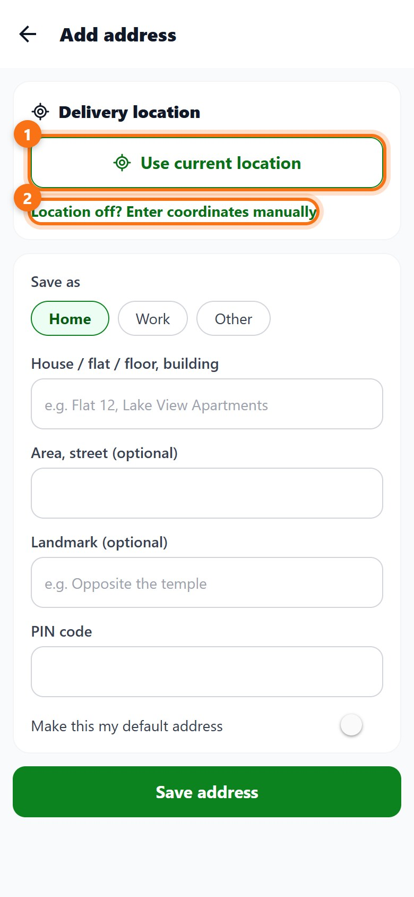

1. Tap **Use current location** while you are at home (or wherever the order should go).
2. Location turned off? Tap **Enter coordinates manually** and paste the numbers from Google Maps (long-press your home in Google Maps to see them).

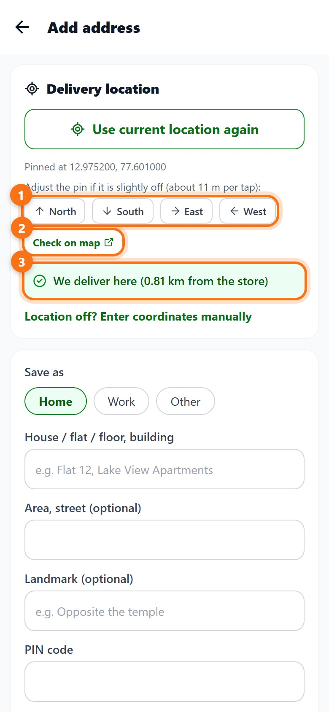

1. If the pin is slightly off, tap **North**, **South**, **East** or **West**. Each tap moves it about 11 metres.
2. **Check on map** opens Google Maps so you can see exactly where the pin is.
3. The green line confirms the store delivers to this address.

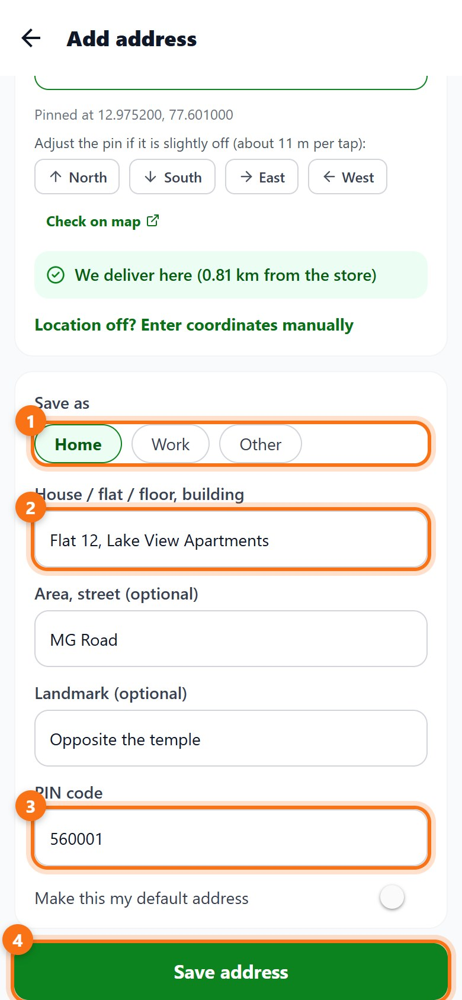

1. Choose **Home**, **Work** or **Other**.
2. Type your **house / flat number, floor and building**. Area and landmark are optional but help the delivery person.
3. Type your 6-digit **PIN code**.
4. Tap **Save address**.

You can save up to 10 addresses. Turn on **Make this my default address** for the one you use most.

---

## 8. Pay and place the order

Back in the cart, the address and the final bill appear.

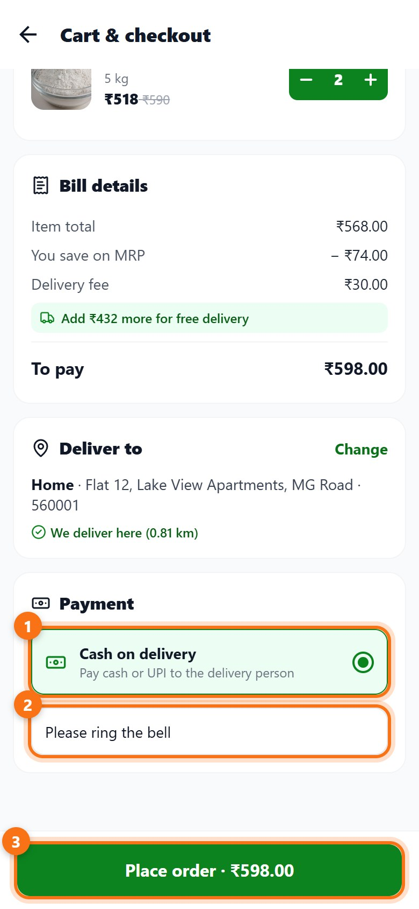

1. **Cash on delivery**: pay by cash or UPI to the delivery person. If the store has online payment turned on, you also see **Pay online** (UPI, cards, net banking).
2. **Note for the store** (optional), for example "Please ring the bell".
3. Tap **Place order**. The button shows the amount to pay.

If **Place order** is grey, the line above it says why: for example the minimum order is not reached, the address is outside the delivery area, or the store is closed.

**Paying online:** the payment screen opens after you tap Place order. The order goes to the store once the payment succeeds. If you don't pay within 15 minutes, the order is cancelled and nothing is charged.

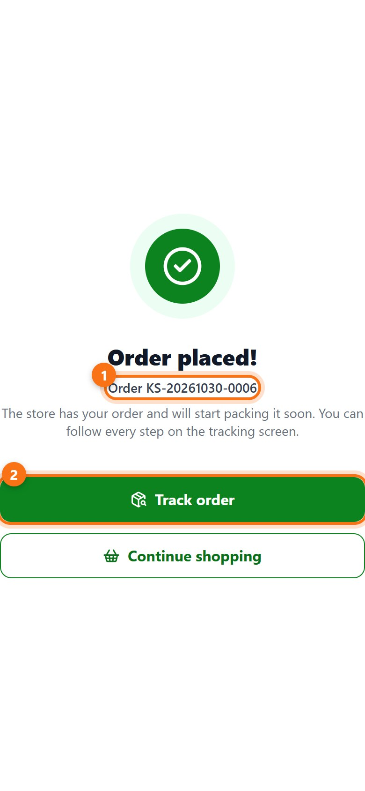

1. Your **order number**. Mention it if you call the store.
2. Tap **Track order** to follow it.

---

## 9. Send your list instead: photo or voice

Don't want to search for each item? Send the store your handwritten list (parchi) or simply say what you need. The store makes the order for you and you see the bill in the app. You pay cash or UPI on delivery. These pictures show the app in Hindi.

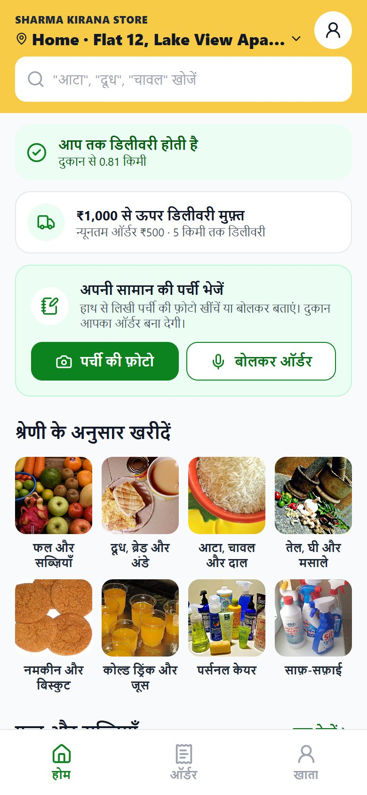

1. On the home screen, tap **पर्ची की फ़ोटो (Photo of list)** or **बोलकर ऑर्डर (Voice order)**.

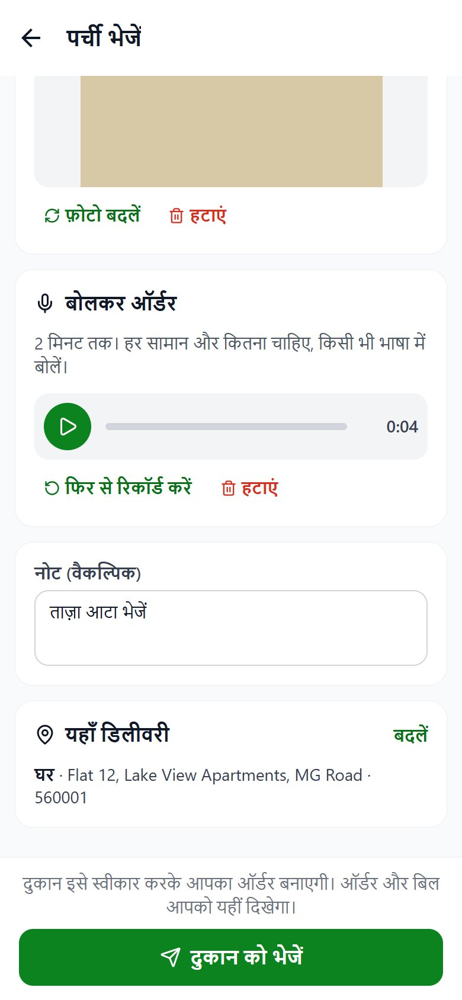

1. **Photo:** tap **फ़ोटो खींचें (Take photo)** or **गैलरी से चुनें (Choose from gallery)**. Keep the whole list in the picture, in good light.
2. **Voice:** tap the microphone and say each item and how much you need, in any language (up to 2 minutes). Tap **रोकें (Stop)**, then ▶ to listen. You can record again or delete it.
3. Add a **note** if you like, and check the **delivery address** (tap **बदलें / Change** to pick another).
4. Tap **दुकान को भेजें (Send to store)**. You can send a photo, a voice note, or both.

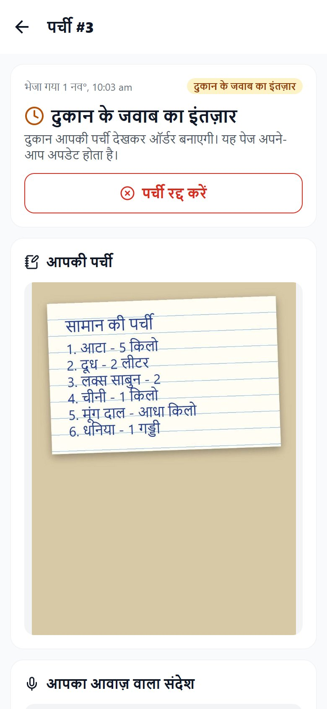

1. The request waits for the store. This screen updates by itself. You can **cancel** it until the store makes the order.

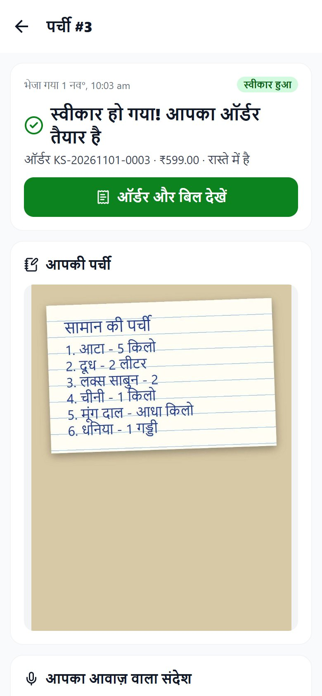

1. When the store accepts, you see the **order number and total**. Tap **ऑर्डर और बिल देखें (View order and bill)**.

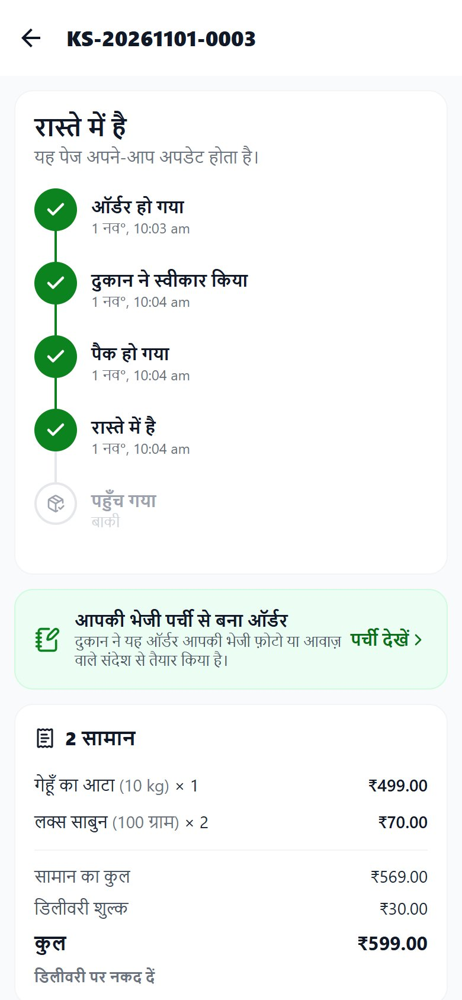

1. The order shows every item and price the store added (including things it priced by hand), the delivery fee and the total, and moves through the same steps as any order.

If the store cannot take a request (for example the photo is unclear), you see its reason and can **send again**. You can have up to 3 requests waiting at a time. All your requests are under **Account → My list requests** and at the top of the **Orders** tab.

---

## 10. Track your order

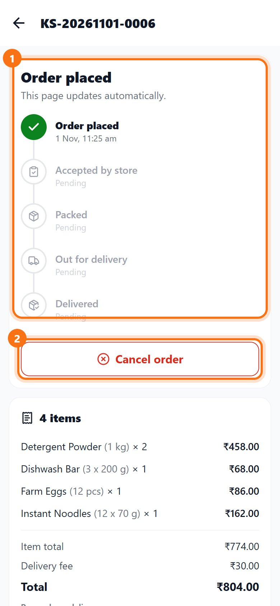

1. The timeline shows each step: **Order placed → Accepted by store → Packed → Out for delivery → Delivered**. The store accepts every order before packing it. This screen updates by itself; you don't need to refresh it.
2. **Cancel order** is shown while the store has not packed your order yet.

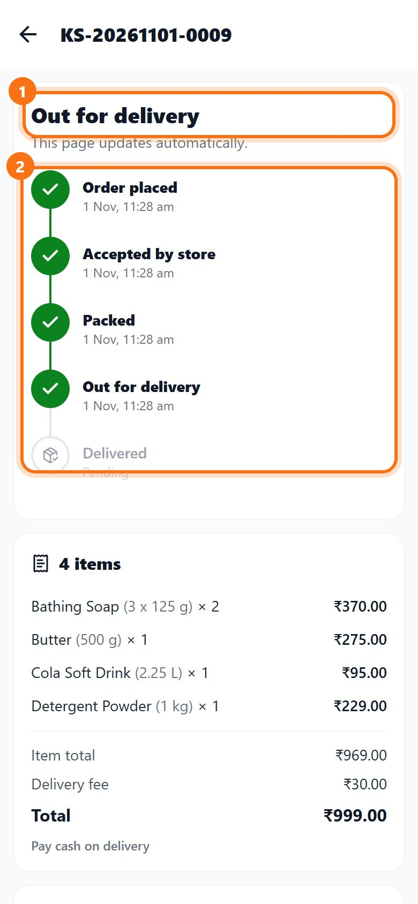

1. The heading shows where your order is now.
2. Finished steps get a green tick and the time.

Further down you see the items, the bill, the delivery address and your note.

---

## 11. Cancel an order

You can cancel until the store packs your order, that is while it shows **Order placed** or **Accepted by store**.

1. Open the order (**Orders** tab, then tap the order).
2. Tap **Cancel order** and confirm.

After it is packed, please **call the store** instead (Account → **Call the store**).

---

## 12. Your orders, account and addresses

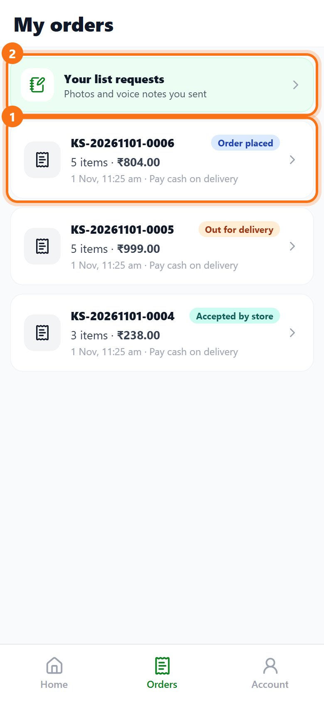

1. The **Orders** tab lists all your orders, newest first, with their status. Tap one to see its details.
2. **Your list requests**: the photos and voice notes you sent, and whether the store has made them into an order.

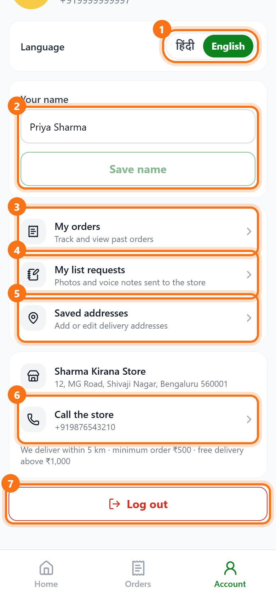

1. **Language**: हिंदी or English.
2. **Your name**: type it and tap **Save name** so the store knows who the order is for.
3. **My orders**.
4. **My list requests**: photos and voice notes you sent to the store.
5. **Saved addresses**.
6. **Call the store**: rings the store directly. The store's address and delivery rules are shown here too.
7. **Log out**.

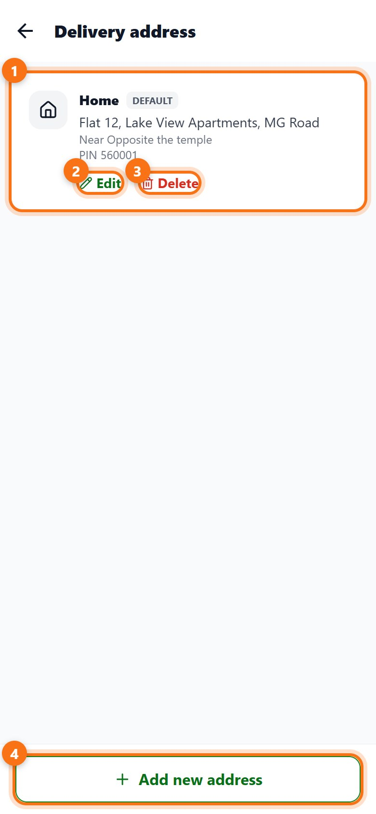

1. Your saved address. **DEFAULT** marks the one used first.
2. **Edit** to change it.
3. **Delete** to remove it.
4. **Add new address**.

To deliver somewhere else for one order, tap the address at the top of the home screen (or **Change** in the cart) and pick another one.

---

## 13. Messages you may see

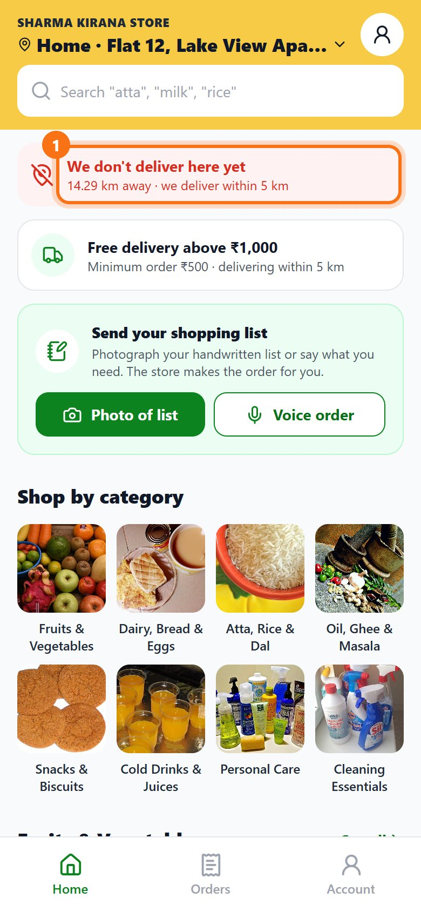

1. **We don't deliver here yet**: you are outside the store's delivery area. It shows how far you are and the store's limit. You can still browse; orders need an address inside the area.

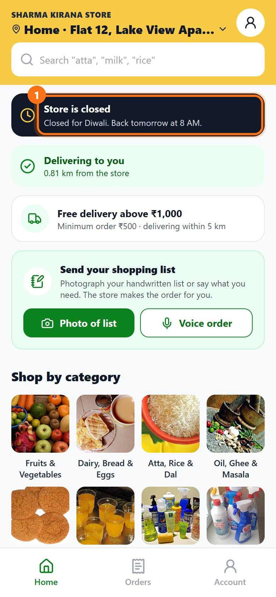

1. **Store is closed**: with the store's message (for example when it reopens). You can browse and fill your cart, but ordering waits until the store opens.

| Message | What it means | What to do |
|---|---|---|
| Add ₹X more to enable order | Below the minimum order | Add more items |
| Add ₹X more for free delivery | You are paying the delivery fee | Optional: add items to reach free delivery |
| Prices updated | A price changed while you were shopping | Check the new total, then tap **Place order** again |
| Some items are unavailable | Something went out of stock | Tap **Remove them**, then place the order |
| Too many OTP requests / Too many wrong attempts | More than 5 codes in an hour, or 5 wrong codes | Wait a while, then request a new code |
| The store couldn't make your list (with a reason) | The store declined a list request, for example the photo was unclear | Tap **Send again** with a clearer photo or voice note, or call the store |
| You already have requests waiting | Up to 3 list requests can wait at a time | Wait for the store to reply, or cancel one you don't need |

---

## 14. Questions

**I didn't get the SMS code.** Check the number, wait 30 seconds and tap **Resend code**. Make sure the phone has signal.

**Location doesn't work.** Turn on location in the phone's quick settings, or use **Enter coordinates manually** when adding the address.

**Can I change an order?** Cancel it before the store packs it (while it shows **Order placed** or **Accepted by store**) and order again, or call the store.

**How do I pay?** Cash or UPI to the delivery person (cash on delivery). Online payment appears when the store turns it on.

**Is my data safe?** The app uses your phone number to log you in and your address to deliver. Your location is used only to check the delivery area. List photos and voice notes are seen only by the store; they are not public.

**Can I use the app in Hindi?** Yes, it starts in Hindi. Switch between **हिंदी** and **English** on the login screen or in **Account → Language**.
